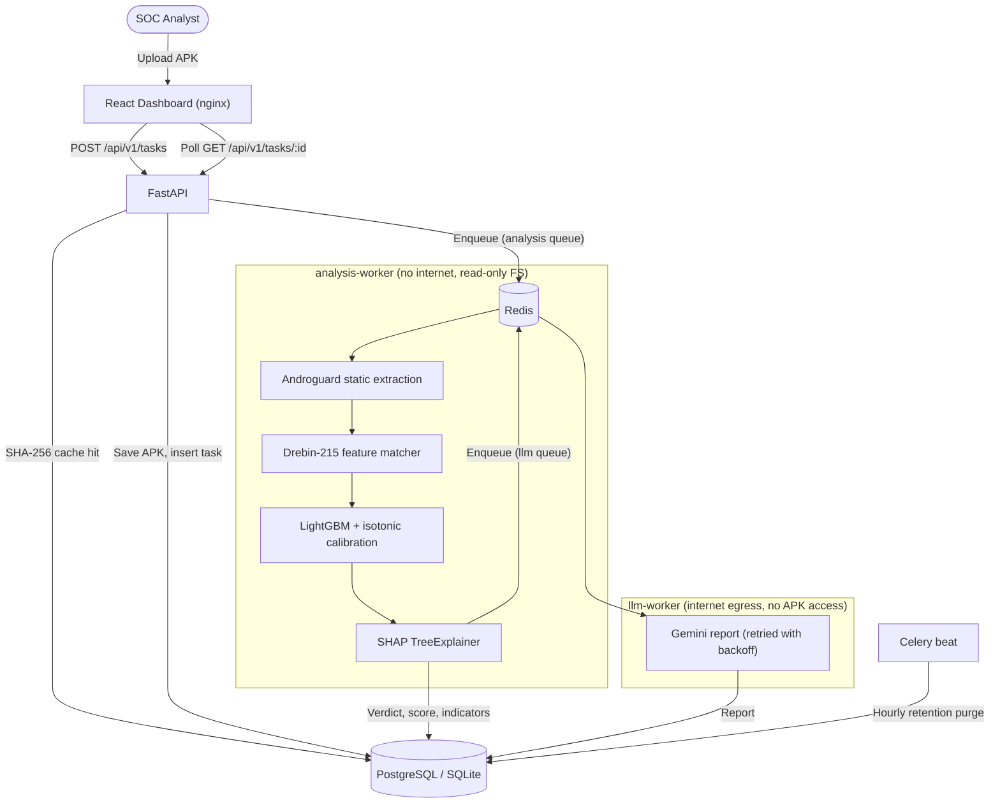

# 🛡️ Nexus-Sec: Android Malware Analysis Platform

[](https://github.com/ABHISHEKGORE2305/BOI_prototype/actions/workflows/ci.yml)
[](https://codecov.io/gh/ABHISHEKGORE2305/BOI_prototype)
[](https://www.python.org/)
[](https://react.dev/)

Upload an Android APK and get back a calibrated malware probability, the indicators that drove it, and an analyst-ready threat report.

**Androguard** static analysis → **LightGBM** classifier trained on Drebin-215 → **SHAP** explanations → **Gemini** report, served by **FastAPI** and **Celery** workers to a **React** dashboard.

<!-- Add a dashboard screenshot here, e.g.  -->

---

## Engineering highlights

- **Found and fixed test-set leakage.** The Drebin CSV has 15,036 rows but only 7,261 unique samples, so a random split put the same apps in train and test and inflated accuracy to ~99%. Training now removes duplicates and conflicting labels *before* splitting. Honest held-out results: **ROC AUC 0.993, 96.1% precision / 93.3% recall at a 1.2% false-positive rate**.
- **Feature extraction that matches the schema.** Drebin's 215 features mix several naming styles (`SEND_SMS`, `Ljava.lang.Class.forName`, `TelephonyManager.getDeviceId`, `HttpGet.init`, `chmod`, intent actions). A category-aware matcher raised features detected on a real APK from **25 to 47**.
- **Scores you can act on.** Isotonic calibration makes the score a real probability, and the decision threshold is tuned on a validation set to a **≤ 1% false-positive budget**.
- **Untrusted input is isolated.** APKs are parsed in a worker with no internet route, a read-only filesystem and no Linux capabilities. The LLM runs in a separate worker that never sees the APK, so a Gemini outage never delays a verdict.
- **Rate limiting that survives scaling out.** A Redis sliding window (one atomic Lua script, server clock) is shared by every API replica and fails open if Redis is down.
- **Tested end to end.** 90% branch coverage. E2E tests generate APKs with a compiled binary manifest, upload them through the API, and run the real Androguard → LightGBM → SHAP pipeline, so no malware samples are needed in the repo. Rate-limiter tests also run against a real Redis in CI.
- **Fast first load.** Charts and Markdown are lazy-loaded with the first result: initial JS dropped from **216 kB to 54 kB** gzipped.

The full list of problems found and how each was fixed is in [docs/ROADMAP.md](docs/ROADMAP.md).

---

## Architecture



| Layer | Technologies |
| :--- | :--- |
| Frontend | React 18, Vite, Recharts, react-markdown, Vitest + Testing Library, nginx |
| API | FastAPI, Pydantic, SQLAlchemy 2, Alembic, prometheus-client |
| Workers | Celery 5 (analysis + llm queues, beat), Redis |
| Analysis & ML | Androguard 4, LightGBM, scikit-learn, SHAP, Google Gen AI SDK |
| Storage | PostgreSQL (Docker) or SQLite (local) |
| Tooling | Docker Compose, GitHub Actions, ruff, ESLint, pre-commit, uv lockfile |

---

## Quick start

Requires Docker with Compose v2.

```bash
cp .env.example .env          # optional: GEMINI_API_KEY, API_KEYS
docker compose up --build
```

Open **http://localhost:8080**. The image trains the model at build time, and the API applies database migrations on start. Without a Gemini key everything works except the written report.

<details>
<summary><strong>Local development without Docker</strong></summary>

Prerequisites: Python 3.10–3.12, Node.js 18+, Redis on `localhost:6379`.

```bash
python3 -m venv venv && source venv/bin/activate
pip install -r requirements.lock -r requirements-dev.txt
python -m nexus_sec.train        # creates models/malware_model.pkl (a few seconds)
alembic upgrade head             # creates malware.db (SQLite)
cd frontend && npm install && cd ..
```

Then, in separate terminals:

```bash
redis-server
celery -A nexus_sec.worker worker -Q analysis,llm -B --loglevel=info
uvicorn nexus_sec.api:app --reload --port 8000     # http://127.0.0.1:8000/docs
cd frontend && npm run dev                         # http://localhost:5173
```
</details>

---

## Model

Trained on **Drebin-215**: 215 binary indicators covering permissions, API calls, intent actions and shell commands.

1. Remove duplicate rows and rows whose features appear with both labels.
2. Stratified 65 / 15 / 20 train / validation / test split.
3. LightGBM (300 trees, `class_weight="balanced"`).
4. Isotonic calibration and FPR-budget threshold selection on the validation set.
5. Save a model bundle whose version is a content hash. Cached scan results are reused only while the version is unchanged.

| Held-out test set (1,451 unique samples) | |
| :--- | :--- |
| ROC AUC / PR AUC | 0.993 / 0.977 |
| Decision threshold | 0.625 |
| Malware precision / recall | 96.1% / 93.3% |
| False-positive rate | 1.2% |

> **Limitations.** Drebin samples are from 2010–2012 and have no timestamps, so a temporal split isn't possible and accuracy on modern malware will be lower. There are no family labels, so the system doesn't name malware families. `python -m nexus_sec.evaluate --csv … | --apk-dir …` measures the model on newer labelled data.

---

## Project layout

```text
nexus_sec/
├── api.py              # FastAPI app: middleware, health, metrics
├── routers/            # HTTP handlers: tasks, model
├── services/           # Upload validation, result cache, enqueueing
├── security.py         # API-key auth, Redis sliding-window rate limiter
├── worker.py, tasks.py # Celery app and pipeline tasks
├── extractor.py        # Androguard extraction
├── features.py         # Drebin-215 feature matcher
├── ml.py               # Calibrated scoring, SHAP, drift
├── train.py, evaluate.py
└── llm.py              # Gemini prompt and client
tests/                  # pytest, incl. e2e with generated APKs
frontend/               # React dashboard (see frontend/README.md)
alembic/                # Database migrations
docs/                   # API, security, operations, roadmap
```

---

## Testing

```bash
pytest --cov                 # unit, API, worker, training and e2e tests
ruff check .
cd frontend && npm test && npm run lint
```

CI (`.github/workflows/ci.yml`) runs lint, trains the model, runs the tests against a Redis service container with an 85% coverage floor, then builds the frontend and the Docker images.

---

## Documentation

- [REST API reference](docs/API.md)
- [Security model](docs/SECURITY.md)
- [Operations, configuration & troubleshooting](docs/OPERATIONS.md)
- [Roadmap: problems found, fixes, and what's left](docs/ROADMAP.md)
- [Frontend](frontend/README.md)
