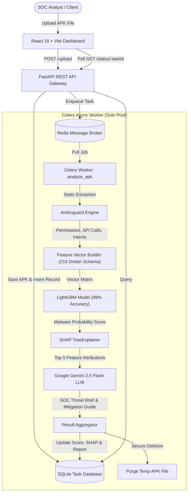

# 🛡️ Nexus-Sec: Android Malware Analysis & Threat Intelligence Platform

[](https://www.python.org/)
[](https://fastapi.tiangolo.com/)
[](https://react.dev/)
[](https://vitejs.dev/)
[](https://docs.celeryq.dev/)
[](https://redis.io/)
[](https://lightgbm.readthedocs.io/)
[](https://shap.readthedocs.io/)
[](https://ai.google.dev/)

**Nexus-Sec** is an enterprise-grade prototype for automated Android APK static analysis, machine learning malware classification, model explainability, and generative AI threat intelligence.

Combining static reverse engineering (**Androguard**), gradient-boosted decision trees (**LightGBM** trained on the Drebin dataset), game-theoretic explainability (**SHAP**), and Large Language Models (**Google Gemini 2.5 Flash**), Nexus-Sec empowers security teams and SOC analysts to detect malicious Android applications, understand *why* they were flagged, and execute immediate remediation playbooks.

---

## 📑 Table of Contents

- [System Architecture](#-system-architecture)
- [Key Features](#-key-features)
- [Tech Stack](#-tech-stack)
- [Directory Structure](#-directory-structure)
- [Machine Learning & Dataset](#-machine-learning--dataset)
- [Prerequisites](#-prerequisites)
- [Installation & Setup](#-installation--setup)
- [Running the Application](#-running-the-application)
- [REST API Reference](#-rest-api-reference)
- [Frontend Dashboard Walkthrough](#-frontend-dashboard-walkthrough)
- [Configuration & Environment Variables](#-configuration--environment-variables)
- [Troubleshooting & FAQ](#-troubleshooting--faq)

---

## 🏛 System Architecture

Nexus-Sec operates on an asynchronous microservices pipeline:



---

## ✨ Key Features

1. **Static Bytecode & Manifest Inspection**:
   - Deep decompilation using **Androguard**.
   - Extracts requested manifest permissions, sensitive API call signatures, dynamic class loading references, and broadcast receiver intent filters.

2. **High-Accuracy ML Detection**:
   - Powered by a **LightGBM Classifier** trained on the **Drebin-215 dataset** (15,036 samples: 5,560 malware and 9,476 benign).
   - Achieves **~99% Precision, Recall, and F1-Score** in classifying Android banking trojans, spyware, and adware.

3. **Explainable AI (XAI)**:
   - Integrates **SHAP (SHapley Additive exPlanations)** via `shap.TreeExplainer`.
   - Identifies and quantifies the exact contribution of each detected feature (permissions, intents, API methods) towards the malicious verdict.

4. **Automated GenAI Threat Intelligence Reports**:
   - Sends the extracted static features and top SHAP attributions to **Google Gemini 2.5 Flash**.
   - Generates an executive technical summary, threat classification, malware family behavioral breakdown, and actionable remediation steps.

5. **Asynchronous & Scalable Pipeline**:
   - Decoupled ingestion and execution via **FastAPI**, **Celery**, and **Redis**.
   - Runs with a `solo` worker pool to eliminate process-fork deadlocks with LightGBM's native C++ multi-threading.
   - Uploaded APK binaries are securely deleted upon task completion.

6. **Cyber-Aesthetic Analyst Dashboard**:
   - Built with **React 18**, **Vite**, **Recharts**, and **Lucide Icons**.
   - Features dynamic risk score gauges, real-time pipeline progress steppers, horizontal SHAP attribution charts, IOC tables, interactive remediation checklist, and live worker logs.
   - Includes an intelligent demo fallback when the backend service is offline.

---

## 🛠 Tech Stack

| Layer | Technologies |
| :--- | :--- |
| **Frontend** | React 18, Vite, Recharts, Lucide React, Vanilla CSS (Space-Dark Cyber Design System) |
| **Backend API** | FastAPI, Uvicorn, Python-Multipart, Pydantic, CORS Middleware |
| **Task Queue** | Celery 5.x, Redis |
| **Database** | SQLite, SQLAlchemy ORM |
| **Static Analysis** | Androguard (Manifest parser, DEX bytecode decompiler) |
| **Machine Learning** | LightGBM, Scikit-learn, Pandas, NumPy, Joblib |
| **Explainable AI** | SHAP (`TreeExplainer`) |
| **Generative AI** | Google Generative AI SDK (`gemini-2.5-flash`), `python-dotenv` |

---

## 📂 Directory Structure

```text
BOI_prototype/
├── app.py                      # FastAPI web server and route definitions
├── celery_worker.py            # Celery instance configuration (solo pool)
├── tasks.py                    # Celery task pipeline: Androguard -> LightGBM -> SHAP -> Gemini
├── database.py                 # SQLite database engine & session factory
├── models.py                   # SQLAlchemy Task entity schema
├── feature_builder.py          # Vectorizer mapping APK features to model schema
├── test_celery.py              # Celery task queue verification script
├── test_db.py                  # Database connection and write verification script
├── requirements.txt            # Python dependencies
├── .env.example                # Template for environment configuration
│
├── datasets/                   # Training data & feature definitions
│   ├── dataset-features-categories.csv              # Drebin feature categorization
│   └── drebin-215-dataset-5560malware-9476-benign.csv # Labeled APK feature dataset
│
├── models/                     # Model artifacts and feature schema
│   ├── feature_names.json      # 215-feature list in vocabulary order
│   └── malware_model.pkl       # Trained LightGBM binary classifier (generated)
│
├── training_models/            # Model training workspace
│   ├── lightgbm.ipynb          # Jupyter notebook for training & evaluating LightGBM
│   └── label_encoder.pkl       # LabelEncoder artifact
│
└── frontend/                   # React + Vite client application
    ├── index.html              # HTML entry point
    ├── vite.config.js          # Vite configuration
    ├── package.json            # Node.js dependencies and scripts
    └── src/
        ├── main.jsx            # React root mount
        ├── App.jsx             # Main threat intelligence dashboard & upload flow
        ├── index.css           # Nexus-Sec custom dark theme CSS design system
        ├── App.css             # Component-specific styles
        └── data/
            └── dummyData.js    # Mock analysis, IOCs, logs, and report data
```

---

## 🤖 Machine Learning & Dataset

The core predictive engine is trained on the **Drebin-215** dataset, a benchmark corpus containing 215 discrete static indicators across:
- **Manifest Permissions** (e.g., `SEND_SMS`, `READ_PHONE_STATE`, `SYSTEM_ALERT_WINDOW`)
- **API Call Signatures** (e.g., `TelephonyManager.getDeviceId`, `Runtime.exec`, `Cipher.getInstance`)
- **Broadcast Receiver Actions & Intents** (e.g., `BOOT_COMPLETED`, `SMS_RECEIVED`)

### Model Specifications:
- **Algorithm**: `LGBMClassifier` (300 estimators, learning rate = 0.05, `class_weight='balanced'`)
- **Performance**:
  - Precision: **0.99** (Class 0), **0.98** (Class 1)
  - Recall: **0.99** (Class 0), **0.98** (Class 1)
  - Overall Accuracy: **99%**

To re-train the model or regenerate artifacts:
```bash
jupyter notebook training_models/lightgbm.ipynb
```

---

## 📋 Prerequisites

Ensure the following tools are installed on your host system:
1. **Python 3.10+**
2. **Node.js 18+** & **npm**
3. **Redis Server** (running locally on port `6379`)
4. **Google Gemini API Key** ([Get an API key here](https://aistudio.google.com/))

---

## 🚀 Installation & Setup

### 1. Clone the Repository
```bash
git clone https://github.com/ABHISHEKGORE2305/BOI_prototype.git
cd BOI_prototype
```

### 2. Configure Backend Python Environment
It is recommended to use a virtual environment:
```bash
python3 -m venv venv
source venv/bin/activate  # On Windows: venv\Scripts\activate
pip install -r requirements.txt
```

### 3. Setup Environment Variables
Create a `.env` file in the project root:
```bash
cp .env.example .env
```
Open `.env` and add your Google Gemini API key:
```env
GEMINI_API_KEY=your_actual_gemini_api_key_here
```

### 4. Install Frontend Dependencies
```bash
cd frontend
npm install
cd ..
```

---

## 🏃 Running the Application

To run the full stack, you need four terminal tabs/processes:

### Tab 1: Start Redis
Ensure the Redis server is running:
```bash
redis-server
```

### Tab 2: Start Celery Worker
Activate your virtual environment and start the worker with the `solo` pool:
```bash
source venv/bin/activate
celery -A tasks worker --loglevel=info --pool=solo
```
> **Note**: `--pool=solo` is required to prevent thread deadlocks between LightGBM's C++ multithreading and Python's default Celery prefork mechanism.

### Tab 3: Start FastAPI Backend
```bash
source venv/bin/activate
uvicorn app:app --reload --host 127.0.0.1 --port 8000
```
The API documentation will be available at: `http://127.0.0.1:8000/docs`

### Tab 4: Start React Frontend
```bash
cd frontend
npm run dev
```
Open your browser and navigate to: `http://localhost:5173`

---

## 🔌 REST API Reference

### 1. Root Health Check
- **Endpoint**: `GET /`
- **Response**:
```json
{
  "message": "API Running"
}
```

### 2. Upload APK for Analysis
- **Endpoint**: `POST /upload`
- **Request**: Multipart Form Data (`file`: `<binary.apk>`)
- **Response**:
```json
{
  "task_id": 1,
  "status": "processing"
}
```

### 3. Poll Scan Status & Results
- **Endpoint**: `GET /status/{task_id}`
- **Response (In Progress)**:
```json
{
  "task_id": 1,
  "filename": "sample.apk",
  "status": "processing",
  "malware_score": null,
  "shap_data": {},
  "llm_report": null
}
```
- **Response (Completed)**:
```json
{
  "task_id": 1,
  "filename": "sample.apk",
  "status": "completed",
  "malware_score": 88.0,
  "shap_data": {
    "SEND_SMS": 1.45,
    "READ_CONTACTS": 0.88,
    "RECEIVE_BOOT_COMPLETED": 0.62,
    "Runtime.getRuntime": 0.54,
    "System.loadLibrary": 0.48
  },
  "llm_report": "### Executive Summary\nThe security pipeline has flagged this APK application as High Risk..."
}
```

---

## 🖥️ Frontend Dashboard Walkthrough

The React client provides an intuitive, high-visibility interface:

1. **Sidebar Controls**:
   - **File Uploader**: Drag & drop or browse `.apk` files.
   - **Scan Depth Configurator**: Choose between Quick Scan, Deep Model, and Full Sandbox.
   - **Target LLM Selector**: Toggle target generative analyst models (Gemini 2.5 Flash, GPT-4o, etc.).
   - **Report Exporters**: Download raw JSON metrics or generate incident PDF reports.

2. **Metrics & Indicators**:
   - **Risk Gauge**: Visual 0–100 risk score with dynamic badge severity (`CRITICAL`, `MEDIUM`, `LOW`).
   - **Malware Family Match**: Displays detected malware family profile and signature alignment.
   - **Pipeline Execution Timer**: Measures end-to-end extraction and classification latency.

3. **Explainability & Threat Intelligence**:
   - **SHAP Feature Impact Chart**: Horizontal bar chart visualizing positive (malicious) vs negative (benign) feature influence.
   - **GenAI Threat Intelligence Report**: Structured report generated dynamically by Google Gemini.

4. **Multi-Tab Investigation Panel**:
   - **Static Analysis**: View detailed manifest permissions, Indicators of Compromise (IOCs), and registered broadcast receivers.
   - **Remediation Playbook**: Interactive checklist for firewall blocks, MDM profile updates, and endpoint quarantining.
   - **System Logs**: Live-streamed terminal output detailing decompilation, inference timing, and cleanup steps.

---

## ⚙️ Configuration & Environment Variables

| Variable | Description | Default / Example | Required |
| :--- | :--- | :--- | :--- |
| `GEMINI_API_KEY` | Google Gemini API key for automated report generation | `AIzaSy...` | Yes |
| `DATABASE_URL` | SQLAlchemy SQLite database connection string | `sqlite:///./malware.db` | Optional |
| `CELERY_BROKER_URL` | Redis broker URL | `redis://localhost:6379/0` | Optional |

---

## ❓ Troubleshooting & FAQ

<details>
<summary><strong>1. Celery worker hangs or freezes during LightGBM inference</strong></summary>

This is caused by process forking conflicts with LightGBM's underlying OpenMP/C++ multithreading. Ensure you launch Celery with the `solo` pool:
```bash
celery -A tasks worker --loglevel=info --pool=solo
```
</details>

<details>
<summary><strong>2. Androguard fails to parse certain DEX files or throws decompression errors</strong></summary>

Some modern APKs use multi-DEX or non-standard manifest packers. Ensure you are using `androguard[magic,GUI]` and have a compatible Python version (Python 3.10 or 3.11 recommended).
</details>

<details>
<summary><strong>3. Gemini API returns "Report generation failed"</strong></summary>

Verify that your `GEMINI_API_KEY` is set in the `.env` file in the root directory and that the API key has quota enabled for `gemini-2.5-flash`.
</details>

<details>
<summary><strong>4. Frontend shows "Demo Mode Profile"</strong></summary>

If the FastAPI server (`http://127.0.0.1:8000`) is offline or unreachable when an APK is scanned, the dashboard automatically falls back to an offline simulated profile with mock threat intelligence data. Start the FastAPI backend and upload again to run live analysis.
</details>
